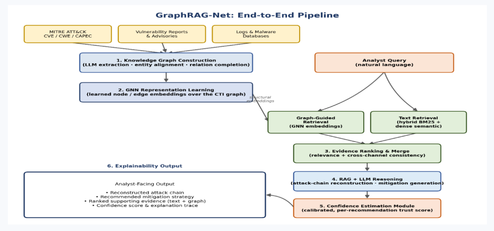

# GraphRAG-Net

> **Hybrid Graph-Augmented Cyber Threat Intelligence (CTI) Reasoning System with Calibrated Confidence Scoring**

GraphRAG-Net combines structured Cyber Threat Intelligence Knowledge Graphs (MITRE ATT&CK, CAPEC, CWE, CVE) with Graph Neural Networks (GNN) and Large Language Models (LLM). It features a **dual-channel hybrid retrieval engine** (Lexical BM25 + GNN structural embeddings) and an empirical **Platt-calibrated confidence scorer** that computes $P(\text{answer is correct})$ with granular sub-scores for security analysts.

---

## 📌 Architecture Overview



---

## 🚀 Quick Start & Prerequisites

### Prerequisites
- **Python**: 3.10+
- **Node.js**: 18+ (optional, required only for modifying the frontend)
- **Docker**: Optional (required only for Neo4j database instance)
- **Groq API Key**: Free tier available at [console.groq.com](https://console.groq.com/keys) (optional if using `--self-test` mode)

---

### Step 1: Clone & Navigate to Repository

```bash
git clone https://github.com/koushikpalakurthi/graphrag-net.git
cd graphrag-net
```

---

### Step 2: Environment Setup

Create and activate a virtual environment, then install Python dependencies:

```bash
# Windows (PowerShell)
python -m venv .venv
.\.venv\Scripts\Activate.ps1

# Linux / macOS
python3 -m venv .venv
source .venv/bin/activate

# Install dependencies
pip install -r requirements.txt
```

---

### Step 3: Configure Environment Variables

Copy the example `.env.example` file to `.env`:

```bash
# Windows (PowerShell)
Copy-Item .env.example .env

# Linux / macOS
cp .env.example .env
```

Open `.env` and configure your API keys and database credentials:

```ini
NEO4J_URI=bolt://localhost:7687
NEO4J_USER=neo4j
NEO4J_PASSWORD=graphrag_dev_pw

# Groq API key (free at https://console.groq.com/keys)
GROQ_API_KEY=your_groq_api_key_here
```

*(Note: If you do not have a Groq API key yet, you can run queries with `--self-test` mode or toggle Mock Mode in the Web UI).*

---

### Step 4 (Optional): Start Neo4j Database

If you want to use the live Neo4j graph store:

```bash
docker compose up -d
```
The Neo4j browser will be accessible at `http://localhost:7474` (Credentials: `neo4j` / `graphrag_dev_pw`).

---

## 🖥️ Running the Project

### Option A: Launch the Web Interface (FastAPI + React Dashboard)

The backend serves both the REST API and the pre-built React interactive visualizer:

```bash
python server.py
```

Open your browser and navigate to:
👉 **[http://localhost:8000](http://localhost:8000)**

#### Web UI Features:
- **Interactive 2D Knowledge Graph Visualizer**: Color-coded nodes (Tactics, Techniques, Mitigations, Software, Groups, Vulnerabilities) powered by Vis-Network.
- **Dual-Channel Provenance Badges**: Indicates whether evidence was surfaced by text BM25, GNN graph topology, or both (`HYBRID_BOTH`).
- **Stage 6 Confidence Cards**: Displays overall confidence percentage, label (`High`, `Medium`, `Low`), and sub-score breakdown (Retrieval Strength, Cross-Channel Agreement, LLM Consistency).
- **Structured CTI Reports**: Attack chain reconstruction and actionable mitigations mapped to MITRE IDs.

---

### Option B: CLI Reasoning Pipeline

You can run queries directly from the command line without launching the server.

#### 1. Live LLM Query (requires `GROQ_API_KEY` in `.env`):
```bash
python scripts/rag_reasoning.py --query "APT29 credential access and phishing techniques"
```

#### 2. Offline / Self-Test Query (no API key required):
```bash
python scripts/rag_reasoning.py --query "APT29 credential access and phishing techniques" --self-test
```

---

## 🔍 Example Query & Output Walkthrough

### Example Query
> `"APT29 credential access and phishing techniques"`

### CLI Execution
```bash
python scripts/rag_reasoning.py --query "APT29 credential access and phishing techniques" --self-test
```

### Sample Output:
```text
=======================================================
STAGE 5 & 6 REASONING & CONFIDENCE: 'APT29 credential access and phishing techniques'
=======================================================

Model Engine: mock-self-test
Calibrated Confidence Score: 0.94 (High)
Calibration Status:          trained_model
Sub-Scores:                 Retrieval=0.54, Agreement=0.75, Consistency=0.85
Analyst Warning Note:        Text and graph search returned lower relevance density; verify entity context.

--- CTI REPORT ---

### 1. Attack Chain Reconstruction
- Phase 1: Initial Access & Entry Vectors — Core techniques identified: Credential Access [TA0006], Initial Access [TA0001], Persistence [TA0003].
- Phase 2: Execution & Persistence — Subgraph relation paths reveal connectivity between credential access and system imaging.
- Phase 3: Lateral Movement & Impact — Primary entities indicate multi-vector threat progression across enterprise hosts.

### 2. Actionable & Grounded Mitigations
- [Credential Access Protection] [M1043] -> Enforce security policy controls as indicated by STIX metadata.
- [Boot Integrity] [M1046] -> Enforce security policy controls as indicated by STIX metadata.
- [Multi-factor Authentication] [M1032] -> Enforce security policy controls as indicated by STIX metadata.

### 3. Graph Provenance & Confidence Assessment
- Channel Consensus: 4 primary entities confirmed by BOTH Text Factual retrieval and GNN Structural similarity.
- Graph Triplet Density: 25 verified 1-hop and multi-hop relation paths.
- Confidence Rating: HIGH (Grounding established via hybrid RRF + graph triplets).
```

---

## 💡 Pre-Packaged Sample Queries

The web dashboard and CLI support multiple predefined query archetypes:

| Category | Example Query | Focus Area |
| :--- | :--- | :--- |
| **Threat Actor / TTPs** | `"APT29 credential access and phishing techniques"` | Spearphishing, LSASS memory dumping, Cozy Bear patterns |
| **Vulnerability / CVE** | `"SQL injection vulnerability in Progress MOVEit Transfer"` | CVE-2023-34362, exploitation mechanisms, web shells |
| **Defense / Mitigations** | `"Living off the land techniques and OS credential dumping mitigations"` | Lolbins, LSA protection, credential guard mitigations |
| **Attack Chain** | `"Spearphishing attachment leading to defense evasion and lateral movement"` | Full progression from T1566 down to impact |

---

## 🛠️ Pipeline Stages & Scripts Reference

If you wish to rebuild the graph, retrain the GNN, or re-calibrate the confidence scorer from scratch:

| Stage | Script | Purpose |
| :--- | :--- | :--- |
| **Stage 1: Ingestion** | `python scripts/download_attack.py`<br>`python scripts/download_capec.py`<br>`python scripts/download_cwe.py` | Pulls STIX, CAPEC, CWE, and CVE data into `data/raw/` |
| **Stage 1: Graph ETL** | `python scripts/parse_stix_to_graph.py`<br>`python scripts/resolve_entities.py` | Extracts nodes and edges into unified JSON representations |
| **Stage 2: GNN Training** | `python scripts/build_pyg_graph.py`<br>`python scripts/train_gnn.py` | Constructs PyG graph and trains link prediction embeddings |
| **Stage 3 & 4: Retrieval** | `python scripts/hybrid_retrieval.py`<br>`python scripts/evidence_ranking.py` | Executes BM25 + GNN reciprocal rank fusion (RRF) |
| **Stage 5 & 6: Reasoning** | `python scripts/rag_reasoning.py` | Synthesizes evidence bundle into structured CTI intelligence |
| **Stage 6: Calibration** | `python scripts/train_calibrator.py`<br>`python scripts/evaluate_calibration.py` | Trains and evaluates Platt-calibrated confidence classifier |

---

## 🌐 REST API Endpoints

The FastAPI backend exposes the following endpoints on port `8000`:

- `GET /api/stats`: Returns graph node count, edge count, embeddings count, and model name.
- `GET /api/samples`: Returns pre-configured sample analyst queries.
- `POST /api/search`: Performs hybrid retrieval, evidence ranking, LLM reasoning, and calibrated scoring.
  ```json
  // Request Body
  {
    "query": "APT29 credential access and phishing techniques",
    "top_k": 8,
    "self_test": false
  }
  ```

---

## 📄 License & Attribution

This project utilizes open Cyber Threat Intelligence taxonomies provided by [MITRE ATT&CK®](https://attack.mitre.org/), [MITRE CAPEC™](https://capec.mitre.org/), and [CISA](https://www.cisa.gov/).
