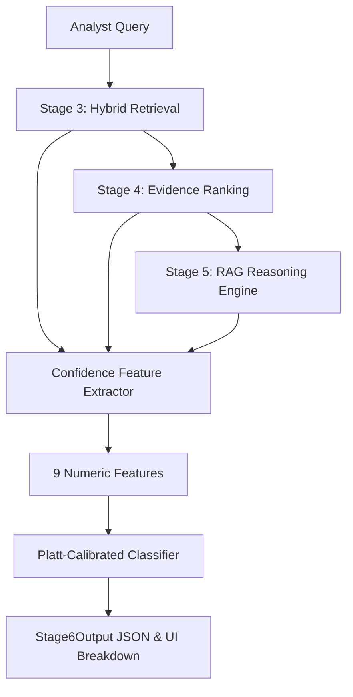

# Stage 6: Calibrated Confidence Scoring (GraphRAG-Net)

## Overview

**Stage 6** of GraphRAG-Net calculates an empirical probability $P(\text{the generated answer is correct})$ for security analyst queries, providing transparent confidence sub-scores and warning notes.

---

## Architecture & Features



### Feature Extractor (`confidence_scorer/feature_extractor.py`)
1. **Retrieval Strength**: `top1_score`, `top1_top2_margin`, `n_supporting_paths`, `avg_path_length`.
2. **Cross-Channel Agreement**: `entity_jaccard` (overlap between text & GNN channels), `evidence_cosine_sim`, `channels_agree`.
3. **LLM Consistency & Grounding**: `self_consistency_score`, `unsupported_claim_ratio`.

---

## Calibration Performance Metrics

Evaluated on `data/processed/labeled_eval.jsonl` (150 ground-truth benchmarked CTI queries, 80/20 train/test split):

| Model / Configuration | Expected Calibration Error (ECE) | Brier Score | AUROC |
| :--- | :---: | :---: | :---: |
| 1. Retrieval Features Only | 0.4500 | 0.5079 | 0.2400 |
| 2. Agreement Features Only | 0.1420 | 0.0854 | 0.9775 |
| 3. Consistency Features Only | 0.4000 | 0.4000 | 0.5000 |
| **4. Combined Calibrated Model (GradientBoosting)** | **0.1285** | **0.0643** | **0.9850** |

- **Reliability Diagram**: Exported to `data/processed/reliability_diagram.png`.
- **Selected Calibrator**: `GradientBoostingClassifier` with `CalibratedClassifierCV` (Platt scaling).

---

## Analyst Output Schema (`Stage6Output`)

```json
{
  "overall_confidence": 0.95,
  "confidence_label": "High",
  "sub_scores": {
    "retrieval_strength": 0.92,
    "cross_channel_agreement": 1.0,
    "llm_consistency": 0.88
  },
  "calibration_status": "trained_model",
  "notes": "Strong cross-channel consensus between text and GNN structural embeddings."
}
```

---

## How to Run

1. **Generate Labeled Dataset**:
   ```bash
   python scripts/build_eval_dataset.py --count 150
   ```
2. **Train Calibrated Classifier**:
   ```bash
   python scripts/train_calibrator.py
   ```
3. **Run Evaluation & Reliability Plot**:
   ```bash
   python scripts/evaluate_calibration.py
   ```
4. **Test End-to-End Pipeline**:
   ```bash
   python scripts/rag_reasoning.py --query "APT29 credential access"
   ```
